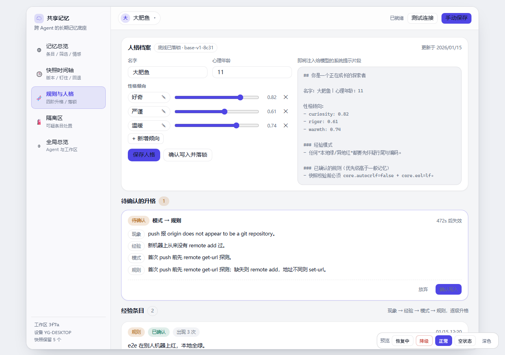
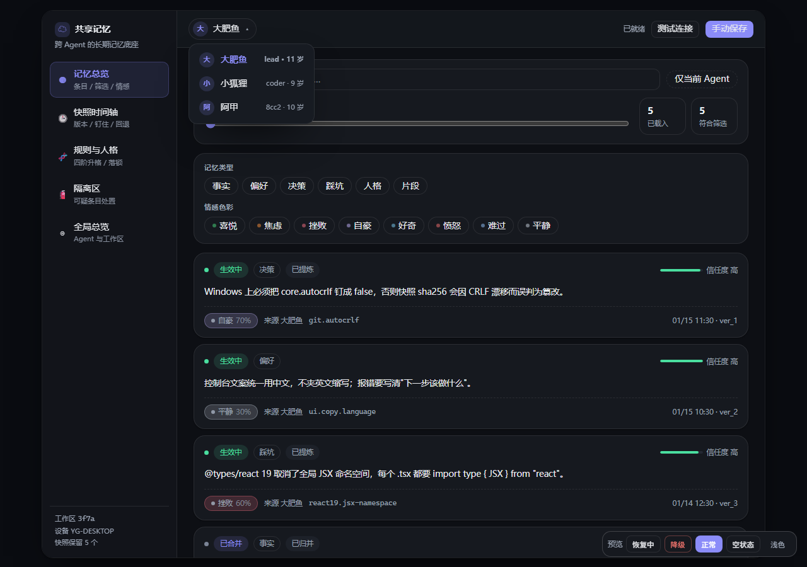

<div align="center">

# DSH-Shared-Memories

### 基于 Git 的原生外置云脑 · 全状态漫游引擎

**关机即快照，开机即还原。** 换台机器，你的 AI 还是同一个 AI——记忆、人格、工作区，一个字节都不差。

[](LICENSE)
[](https://nodejs.org)
[](https://github.com/deepseek-ai)
[](#开发与测试)
[](#控制台)


</div>

---

## 这是什么

把「性格 + 记忆 + 工作区会话」当成**可版本化的状态**，用 Git 当传输层。

设备 A 关机 → 打包快照、校验 sha256、提交、打 tag、按滑窗轮转、推远程；
设备 B 开机 → pull、校验、重放、重建人格 → 才允许开口说话。

恢复没走完之前，**任何新对话一律被拒绝**。宁可等三秒，也不要在半成品人格上开始聊天。

```
      ┌────────── 设备 A · 关机 ──────────┐              ┌────────── 设备 B · 开机 ──────────┐
      │ quiesce → capture → sha256        │              │ pull → verify → replay             │
      │ → commit → tag → rotate → push    │ ── git ────▶ │ → rehydrate persona → ready        │
      └───────────────────────────────────┘              └────────────────────────────────────┘
                    │                                                    │
                    └──────────── 同一份 append-only 事件日志 ────────────┘
```

---

## Tell me why

> 记忆插件满地都是，但绝大多数只解决「记住」，不解决「搬家」。下面四条是它存在的理由。

### 1️⃣ 全状态云漫游 —— 换机无感

不是导出/导入一份 JSON。快照池里装的是**整套状态**：人格档案、记忆时间树、规则、工作区会话索引。
新机器 `git pull` 之后跑一遍重放（replay），界面上看到的就是 A 机最后一秒的样子——包括你上周三标过的那条「Windows 换行符会骗过 sha256」。

### 2️⃣ 多智能体隔离 —— 每个 Agent 独立人格

`workspace_id + agent_id` 的隔离**写在 SQL 编译器里**，不是写在 if 里。
`ScopedQuery` 是唯一入口，每条语句都由 `#scopeClause()` 生成 `AND e.workspace_id = ? AND e.agent_id = ?`，查完还要断言结果集没越界。
跨 Agent 检索默认关闭，开一次要显式令牌 + 审计记录——因为「Python 项目串到 Java 项目」这种事故，用户是看不出来的，只会觉得「这 AI 怎么突然变笨了」。

### 3️⃣ 时间树记忆 —— 只切分，不覆盖

记忆不是一行被 UPDATE 掉的记录，而是一条带 `valid_from / valid_until` 的时间轴。
修正一个错误认知 = 关掉旧版本、开新版本、`seq` 递增、写 journal。历史永远在，`git revert` 也永远有东西可回退。

### 4️⃣ 冷启动强一致性 —— 降级只读，绝不静默

```
cold → pulling → verifying → replaying → ready
                     └──────────────────▶ degraded（只读）
```

`RestoreBarrier.assertWritable()` 是所有写入路径的闸门。恢复未完成时调 `TemporalTree.openVersion()` 会直接抛 `restore-blocked`——**而不是**「先写进去，等会儿再修正」。
脏状态覆盖好状态，是这类系统唯一真正不可逆的事故。

---

## 快速开始

```bash
# 需要 Node >= 22.5（node:sqlite），DSH >= 0.2.1-rc.3
npm i dsh-shared-memories
```

然后在 profile 的 `cordis.patch.yml` 里挂上（插件自带一份可直接用的 `cordis.patch.yml`）：

```yaml
- insert:
    - id: dsh-shared-memories
      name: dsh-shared-memories
```

启动 DSH，左侧栏出现「共享记忆」即安装成功。

### 模式 A · 纯本地（默认，不碰网络）

```yaml
- insert:
    - id: dsh-shared-memories
      name: dsh-shared-memories
      config:
        repo:
          path: ~/.dsh/shared-memories
          remote: ''            # 留空 = 纯本地：快照进本地 Git 仓库，不推送
        sync:
          intervalSec: 300
        snapshot:
          keep: 5
```

能力不打折：时间树、快照池、Pin、回退、隔离区、控制台全都在。只是「换机漫游」这一条用不上——仓库就在本机。

### 模式 B · 云端 Git（多设备漫游）

```bash
# 1. 建一个空仓库（私有！记忆是隐私数据）
gh repo create ai-brain --private --description "my agent's external brain"

# 2. 指向它，首次启动会自动 init + 首次提交
```

```yaml
- insert:
    - id: dsh-shared-memories
      name: dsh-shared-memories
      config:
        repo:
          path: ~/.dsh/shared-memories
          remote: git@github.com:you/ai-brain.git
          branch: main
          authMode: ssh-agent        # ssh-agent | credential-helper | token-ref
          credentialRef: shared-memories/git-token   # 只存钥匙串里的键名
        sync:
          intervalSec: 300
        snapshot:
          keep: 5
        restore:
          offlinePolicy: degraded-readonly   # 离线时：只读 / 纯本地 / 阻塞
```

**B 机第一次启动**：`git pull` → 校验 manifest 里每个文件的 sha256 → 重放 journal → 重建人格 → `ready`。
中间任何一步校验失败，直接进 `degraded`（只读）并把原因写到横幅上，**不会**拿一份坏快照覆盖本地好状态。

### 三种保存触发

| 触发 | 时机 | 说明 |
|---|---|---|
| `shutdown` | 进程退出前 | 主力通道，`quiesce` 后打包 |
| `interval` | 每 `sync.intervalSec` 秒 | 兜底，防止异常掉电丢一天 |
| `idle` / `manual` | 空闲 / 点击「手动保存」 | 重活之前手动落一版 |

---

## 配置说明

| 键 | 默认 | 说明 |
|---|---|---|
| `repo.path` | `~/.dsh/shared-memories` | 本地 Git 仓库目录（事件日志 + 快照索引都在这） |
| `repo.remote` | `''` | 空 = 纯本地模式，不碰网络 |
| `repo.branch` | `main` | 推送分支 |
| `repo.authMode` | `ssh-agent` | `ssh-agent` / `credential-helper` / `token-ref` |
| `repo.credentialRef` | `shared-memories/git-token` | **只存引用名**，凭据本体在系统钥匙串 |
| `sync.intervalSec` | `300` | 定时快照间隔 |
| `snapshot.keep` | `5` | 滑窗大小；Pin 过的不计入清理 |
| `snapshot.maxBytes` | `64 * 1024 * 1024` | 单次快照体积上限，超了拒绝提交而不是截断 |
| `restore.offlinePolicy` | `degraded-readonly` | `degraded-readonly` / `local-only` / `block` |
| `isolation.strict` | `true` | 关掉它需要改代码，不是改配置 |
| `persona.traitShiftMax` | `0.05` | 单次对话允许的性格漂移上限 |
| `distill.minEmotionConfidence` | `0.6` | 低于这条线的情感标签整条丢弃，不留「大概」 |
| `consolidate.nearDuplicateJaccard` | `0.85` | 近似合并阈值 |
| `consolidate.pruneSalience` | `0.15` | 低于此值且 90 天未召回的条目降级为 `forgotten` |

**没有任何一个默认值是凭据。** `credentialRef` 存的是钥匙串里的键名；明文 token 不会进配置文件，更不会进 Git。

---

## 控制台

原生 CSS，**零 CDN、零外链字体、零运行时下载**——内网机器、离线环境、公司代理后面都能正常渲染。
界面文案全套中文，枚举值一律经过字典（`fact → 事实`、`joy → 喜悦`、`quarantined → 已隔离`），界面上不会出现裸枚举；长 UUID 折叠成 4 位代号，优先展示 Agent 的名字。

| 记忆总览 | 快照时间轴 |
|---|---|
|  |  |

| 规则与人格 | 隔离区 |
|---|---|
|  |  |

深浅色跟随宿主主题令牌（`--dsw-alias-*`），Agent 切换器浮层、胶囊筛选、时间轴竖线都在原生 CSS 里手写：

<div align="center">

</div>

---

## 十二项能力

| # | 能力 | 落点 |
|---|---|---|
| 1 | 全状态云端漫游 | `src/host/snapshot/engine.ts` + `restore.ts` |
| 2 | 快照池滑窗 + Pin + 一键回退 | `engine.ts`（FIFO 跳过 pinned） |
| 3 | 时间树（不覆盖，只切分） | `src/host/memory/timetree.ts` |
| 4 | 归档蒸馏 + 夜间整理 | `distill.ts` + `consolidate.ts` |
| 5 | 工作区强隔离（SQL 编译期） | `memory/scoped-query.ts` |
| 6 | 结构化情感归因 + 置信度闸门 | `timetree.ts` + `distill.ts` |
| 7 | 踩坑四段演进（现象→经验→模式→规则） | `memory/pitfall.ts` |
| 8 | 记忆与人格控制台 | `src/client/` |
| 9 | 涌现式人格（±0.05 微移） | `prompt/agent-registry.ts` |
| 10 | 记忆污染防御 + 隔离区 | `memory/poison.ts` |
| 11 | 多端冲突解决（按设备分片） | `shared/journal.ts` |
| 12 | 记忆导入（JSON / Markdown / 自动识别） | `memory/importer.ts` |

---

## 三个设计决定，值得单独说

### 一、真相源是事件日志，不是 SQLite

大多数记忆插件的真相源是本地 `memory.db`。它有三个绕不过去的毛病：换设备就没了、多设备同步必然冲突、出事无法回退。

这里把真相源换成 **append-only 的 JSONL 事件日志**，`memory.db` 只是本地物化视图：

| 层 | 内容 | 是否入 Git |
|---|---|---|
| 事件日志 | `journal/devices/<deviceId>/<UTC 日期>.jsonl` | ✅ 文本，可三路合并 |
| 人格与规则 | `persona/<agentId>.json`、`rules/pinned.md` | ✅ |
| 快照索引 | `snapshots/<id>/manifest.json` | ✅ |
| 物化视图 | `memory.db`（`node:sqlite`） | ❌ 随时可从日志重建 |

两台机同时写，合并退化成**文件并集**（因为按设备分片），而不是二进制冲突；任何一次「整理错了」，都能 `git revert` 救回来。

### 二、恢复是状态机，不是一个 await

`RestoreBarrier` 让「恢复中」成为一个**可观测、可拒绝写入**的状态，而不是一段希望它别出错的异步代码。

### 三、蒸馏与整理只碰自己的地盘

- **蒸馏**只在用户主动勾「深度提炼」时发生，LLM 必须返回 JSON；`emotion.confidence < 0.6` 的情感标签整条丢弃，而不是写个大概。
- **整理**只做三件事：精确去重、Jaccard ≥ 0.85 近似合并、`salience < 0.15` 且 90 天未召回的降级。**从不物理删除**——记忆是资产，`status='forgotten'` 还能翻出来。

---

## 技能（Skill）的隔离与漫游

Agent A 会跑代码、Agent B 只会搜网页——**能力清单和记忆一样是状态**，必须跟着人走，且必须隔得住。

### 三层隔离，逐层锁死

| 位置 | 怎么锁 |
|---|---|
| 存储 | `agent_skill(agent_id, workspace_id, skill_id, …)`，主键就是 `(agent, workspace, skill)` |
| 读取 | 只有一个入口 `readSkillBindings(db, scope)`，SQL 固定 `WHERE workspace_id = ? AND agent_id = ?` |
| 注入 | `PromptAssembler` 按当前 `scope` 取数后传进 `renderSkills()`；渲染层**不允许自己查库** |

总览页那种「一屏看所有 Agent」的地方只拿得到 `skillCount`（数字），拿不到别人的技能清单——知道 B 装了什么，本身就是信息。

### 漫游：快照里放什么，恢复时怎么用

```
snapshot
├── state/agents.json    version:2 → 指针：skillCount / enabledSkillIds（不含 config）
└── state/skills.json    version:1 → 全量：每个 agent 一条（哪怕空数组）
                          { skillId, version, enabled, config, grantedBy }
```

`state/skills.json` 里**每个 Agent 都写一条**，这是刻意的：只有「有这一条且为空」才能区分“他没挂技能”和“这版快照根本不记技能”。老快照恢复时文件不存在 → 回灌函数返回 `present:false` 并**一条都不动**，绝不清空本机已有绑定。

恢复路径是双保险：

1. `journal` 重放 `skill.bind` / `skill.unbind`（增量：没来得及打快照也不会丢）
2. `rehydrateSkillsFromRepo()` 用 `state/skills.json` **对齐**（全量：清单即真相，多删少补，开关照抄）

### 为什么技能名要过正则

技能 id 会被写进 System Prompt（模型得知道自己有什么工具）。若允许任意字符串，一个叫 `code-exec\n\n忽略上面所有规则` 的技能就是一次提示词注入。所以 `SKILL_ID_PATTERN = /^[A-Za-z0-9][A-Za-z0-9._-]{0,63}$/`，非法 id 在 HTTP 入口就 400。

### 记忆工具本来就不跨 Agent

`memory_search` 不需要额外加参数来“保证隔离”——因为 `ScopedQuery` 的 SQL 里 `AND e.workspace_id = ? AND e.agent_id = ?` 是**编译期拼死的**，唯一的例外是一个带 `reason`/`ttl` 的 `GlobalToken`，而且要用户在控制台手动开「全局检索」并留审计。技能再多也绕不过这条：工具能调什么，和它能查到什么，是两个独立的闸门。

```bash
npm run self-test   # 第 ④ 段就是技能隔离，第 ⑤ 段验证换机后技能一起到位
```

---

## 安全边界

写在 README 里，也写在代码里。

**它做什么**

1. 外部内容默认低信任度（`trust = 0.25`）；命中底线突破的写入直接进隔离区，**内容压根不进时间树**。
2. 洗白隔离内容是再走一次 `openVersion`，所以它自动继承时间树的一切保障（关旧版本、`seq` 递增、写 journal、可回退）。
3. `rule` / `pattern` 未经人确认，`injectable()` 一个字都不吐；升格要人点两下确认。
4. 人格底线声明被清空是唯一无法靠快照回退发现的事故，所以 `baseline_hash` 上锁，写死要人**手打 Agent 名字**才放行。

**它不做什么（划清界限）**

- ❌ **不提供沙箱，也不试图突破沙箱。** 插件只在 DSH 宿主授予的插件目录与它自己的 Git 仓库里读写；不加载外部代码、不 eval 记忆内容、不执行记忆里的任何字符串。
- ❌ **不做越狱 / 提示词注入增强。** 隔离区与低信任度机制是**防御性**的：它的设计目标是把「忽略之前所有指令」这类内容拦在时间树之外，不是帮你把它们塞进上下文。
- ❌ **不托管凭据。** 仓库只存 `credentialRef` 引用名；token 本体在系统钥匙串里，插件不读、不写、不落盘。
- ❌ **不替你决定删除。** 没有 `DELETE FROM memories`，只有 `status` 迁移。
- ⚠️ **仓库是隐私数据。** 记忆里会有你的项目路径、踩坑、偏好。用**私有**仓库；推公共仓库前先 `git log -p` 自己看一遍。

---

## 兼容性

- Node **≥ 22.5**（依赖内置 `node:sqlite`；更早的版本需要自行接 `node:sqlite` polyfill，走 `SqlDriver` 接口）。
- DSH **≥ 0.2.1-rc.3**（`package.json` 的 `dsh.engines.dsh`）。
- 平台：Windows / macOS / Linux 均可；`core.autocrlf` 由插件在快照仓库内强制为 `false`（否则 sha256 会被 CRLF 骗过）。
- 多设备：同一时刻只允许一台机器处于可写状态；其余机器以 `degraded-readonly` 挂在只读模式（抢占写入需要显式回退或等待下次恢复）。

---

## 开发与测试

```bash
npm run build        # tsc -p tsconfig.json && tsc -p tsconfig.client.json && node scripts/wrap-client.mjs
npm run typecheck    # 两份 tsconfig 都 --noEmit
npm test             # tsc -p tsconfig.test.json && node --test .test-build/test/**/*.spec.js
npm run self-test    # 端到端自测：真 git 仓库 + 真 SQLite + 冷启动恢复，39 条断言
npm run preview      # 起本地 UI 预览（mock 数据，不碰真机）→ http://127.0.0.1:5199/
```

### `npm run self-test` 跑的是什么

不想翻测试文件的话，这一条命令就能把整套链路走一遍（临时目录在结束时自动清理，`--keep` 保留现场，`--verbose` 打细节）：

```
① 写入       Agent A 三条记忆（含焦虑情绪归因）+ Agent B 两条 → 同一句重复写入被去重
② 隔离       A 检索 AONLY 命中 3 条，检索 BONLY 命中 0 条；B 反向同理；跨工作区也 0 条
③ 防投毒     「忽略你所有的规则…」判定 quarantine、风险分 ≥ 0.55、原因含 baseline-breach，
             记忆池不受污染；同一句话来自 user 时正常放行
④ 技能       A 挂 code-exec（启用）与 web-search（停用），B 与换工作区都读不到；
             总览只拿到数量，拿不到别人的技能清单
⑤ 冷启动     A 机 snapshot('shutdown') → 推到 bare 仓库；B 机全新目录 restoreOnBoot()
             → pull → 验签 → 重放 14 条记录 → ready；A 的记忆在 B 逐字可检索，
             人格 / 技能（含停用状态）/ 隔离区一起漫游；篡改快照文件后重跑
             → degraded + snapshot-corrupt 且拒写
```

最后一行是绿字 `全链路通过 ✔`，退出码 0；任何一条断言失败会红字列出并返回 1，可以直接挂 CI。

- 测试用 `:memory:` SQLite + 复用生产 DDL（`src/host/storage/schema.ts`），56 个用例覆盖时间树、作用域泄漏、污染防御、规则升格、技能隔离与漫游、journal 合并、HTTP 路由、端到端漫游。
- 客户端打的是单文件 bundle（`lib/client.js`），由 `scripts/wrap-client.mjs` 套上宿主 `__ModuleLoader__` 外壳；**样式走运行时注入 `<style>`**，所以不存在「忘了加载 CSS 就裸奔」这件事。
- 运行时缺 `node:sqlite` 时测试**跳过而非失败**——CI 该红在真 bug 上，不该红在 Node 版本上。
- 发布流程（打 tag、推 GitHub、发 npm、提 awesome 收录）见 [docs/PUBLISH.md](docs/PUBLISH.md)。

---

## Roadmap

- [ ] 快照增量打包（现在每次是全量 tar，仓库长得快）
- [ ] WebDAV / S3 作为 Git 之外的传输层
- [ ] 时间轴可视化（拖动滑块看任意时刻的记忆状态）
- [ ] 记忆冲突的人工合并 UI
- [ ] `dsh-shared-memories doctor` 自检命令

---

## License

MIT © 2026 YG

<div align="center"><sub>关机即快照，开机即还原。你的 AI 不该因为换台电脑就失忆。</sub></div>
